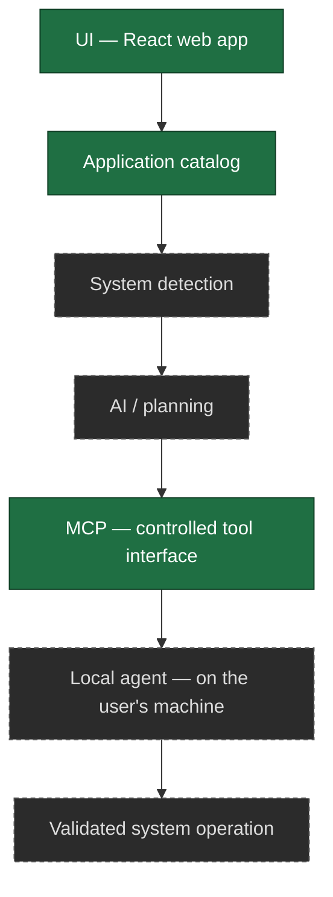
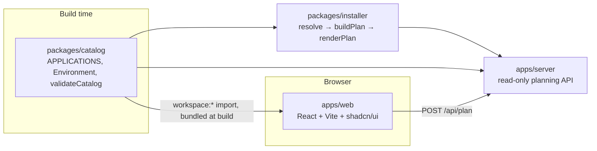

# Architecture

This document describes two things, kept separate: what is actually implemented today,
and the long-term architecture the project is working toward. Do not read the long-term
section as shipped functionality — check the "Current implementation" section (or the repo
itself) for what actually runs.

## Long-term architecture (planned)

The platform is designed around a strict separation of layers:

```
UI                 ✻  React web application
   ↓
Application Catalog   Curated application data, independent of the UI
   ↓
System Detection      What the user's Linux system looks like
   ↓
AI / Planning         Recommendation, compatibility, and plan generation
   ↓
MCP                   A controlled, tool-based interface for external clients ✅
   ↓
Local Agent           Runs on the user's machine — Future scope, nothing implements it
   ↓
Validated System
Operation             The only layer that can change the system
```

The **Local Agent** layer is deliberately listed here even though it is unstarted: the
security model's "privileged operations belong in the local agent" principle only makes
sense if the layer is named. See [`agent.md`](agent.md) for the rules it must follow, and
[`ROADMAP.md`](ROADMAP.md) for where it sits (post-core, after MCP).

Each layer is intentionally decoupled so security boundaries can be enforced at each hop:
nothing downstream runs arbitrary input, and nothing upstream can touch the operating
system directly. See `docs/security-model.md` for the security model this enables.



Solid boxes exist today; dashed boxes do not.

## V1 architecture (in progress)

V1 narrows the long-term pipeline to a smaller, concrete flow that stops before any system
access:

```
Website → Linux detection state → Distribution selection → Application catalog
→ Application selection → Installer resolution → Terminal command generation
→ Copy to terminal → user runs it themselves
```

The website never executes anything — it ends at a command the user copies and runs in
their own terminal. Installer resolution and command generation are not part of Phase 1
(see below).

## Current implementation

The catalog, the deterministic core, and a read-only API over it all exist:



The catalog is *compiled into* the web bundle; it is not fetched at runtime. Browsing,
search, category filtering and role presets therefore work with no server at all.

The web app makes **two kinds of network request**, both to ConfigShell's own API:
`POST /api/plan` to generate a setup plan, and `GET /api/applications/:id?distro=…` to ask
how one application resolves for a distribution.

That split is deliberate. The web app could import `packages/installer` directly, but that
would put the one security-critical function in the browser bundle and give two consumers two
places to drift apart. The detail view is the cautionary example: it once computed
applicability itself and disagreed with the plan — highlighting VS Code's `apt` source as
applying to Ubuntu while the plan installed the Snap, because the local copy did not know
that a vendor package-manager source needs a repository added first. It now asks the
resolver.

The cost is visible rather than hidden: without the API you can browse and select but not
generate a plan or see per-source availability, and the UI says exactly that instead of
degrading quietly.

### The four stages, and why they are separate

```
resolve()           (application, environment)  →  which source, and why
buildPlan()         (resolutions, environment)  →  ordered steps, as DATA
renderPlan()        (plan)                      →  command strings
presentSetupPlan()  (applications, environment) →  the plan an adapter returns
```

The first three are the security model rather than tidiness. `renderPlan` is the **only**
code in the repository that knows `apt` means `apt-get install`; everything before it is
structured data that cannot contain a shell fragment. That keeps the dangerous step small
enough to test exhaustively, and it is what lets a future CLI reuse resolution and planning
without inheriting command generation.

`presentSetupPlan` runs all three and flattens the result into **the canonical setup plan**
— the single wire shape. It exists because the flattening was previously done twice, once
per adapter:

```
                    ┌─────────────────────────────────────────┐
                    │        packages/installer               │
   catalog ids ───► │  resolve → buildPlan → renderPlan       │
   + environment    │                 │                       │
                    │                 ▼                       │
                    │        presentSetupPlan()  ◄─ validate   │
                    └─────────────────┬───────────────────────┘
                                      │  one PresentedSetupPlan
                        ┌─────────────┴─────────────┐
                        ▼                           ▼
              apps/server (HTTP)            packages/mcp (stdio)
              POST /api/plan                generate_setup
                        │                           │
                        ▼                           ▼
                    apps/web                    MCP host
```

Each adapter still does its own **input** handling — resolving ids and refusing an unknown
one, because a refusal looks different over HTTP than it does over MCP — and nothing else.
The plan itself is built once.

That matters because the two adapters do not call each other: MCP does not go over HTTP, so
nothing at the transport level forces them to agree. When each shaped its own plan they
drifted — HTTP grew `summary.executed` while MCP grew a richer `execution` block, and HTTP's
manual steps leaked internal step fields that MCP's did not — and the cross-adapter tests
compared the fields both happened to share, so neither difference failed anything.
`tests/contract` now compares the whole object, which is the assertion that would
have caught it.

`presentSetupPlan` validates its own output before returning it (`validateSetupPlan`): the
counts must add up, the privileged count must match the commands, and every command must
match a narrow allowlist — checked on the finished string, after interpolation. A plan that
fails throws rather than being returned with a warning. The plan is also **deterministic**:
no clock, no randomness, no generated ids, asserted by comparing two serialised runs.

It is also why the core lives in a package rather than in `apps/web` or `apps/server`. Both
are consumers. Neither owns the logic, and neither may reimplement it.

The web app owns no application data. It reads `APPLICATIONS` from the catalog package and
renders it; search, category filtering and selection all operate on catalog entries, keyed
on `Application.id`. The Phase 1 fixture `apps/web/src/data/mockCatalog.ts` has been
deleted, so there is exactly one source of truth. The `Distro` union is likewise defined in
the catalog and imported by `apps/web/src/components/environment/distros.ts`, which now only
supplies the selector's presentation copy.

The catalog carries the structured metadata the layers downstream of it consume (`method`,
`identifier`, `origin`, `distros`) and stops there — it holds no command text and no
execution. Resolution, planning and command generation live in `packages/installer`;
execution exists nowhere and belongs to the local agent (`docs/agent.md`).

### `packages/catalog` — the shared catalog

TypeScript source, no build step; `apps/web` depends on it via `workspace:*` and both Vite
and `tsc` resolve it through the pnpm symlink. Holds the data model, 31 verified
applications, a dependency-free validation function, and its own test suite (Node's test
runner via `tsx`). See `docs/catalog.md` for the schema, the verification rules, and what
is deliberately absent.

### `apps/web` — the UI layer

Implements the whole deterministic flow: environment (OS + distribution) → optional role
presets → browse/search/filter → application detail → selection → setup plan → commands.
Two views held in `App.tsx`, which owns selection state: `build` (one scrollable page,
because every part of it is revised while looking at the rest) and `plan`.

It must **not** import `@configshell/installer` — one implementation of command generation,
not two. Plan generation goes through `src/lib/api.ts`.


Built primarily from **shadcn/ui** (Radix UI base) components under
`src/components/ui/` (button, card, badge, checkbox, radio-group, input, toggle-group,
separator, scroll-area, alert, sheet, empty, label, tooltip) rather than hand-rolled
markup. `components.json` holds the shadcn config; see `AGENTS.md`'s "shadcn/ui setup"
section before adding more components or touching the `@/*` import alias.

- `src/App.tsx` composes the page inside a `TooltipProvider`: `SiteHeader` (layout),
  `EnvironmentStep` (which renders `LinuxDetectionCard` for detection, `OsSelector` and
  `DistroSelector`), `RoleSelector` (presets), `AppCatalog` (applications, which renders
  `AppCard`s), `SelectionSummary` (selection, desktop sidebar), and `SelectionBar`
  (selection, sticky bottom bar — a sheet + inert "Continue" button on mobile).
- Everything that spans the page — header, main grid, sticky selection bar — renders inside
  `src/components/layout/PageContainer.tsx`, the single content container. Its width and
  gutter come from `--layout-max-width` / `--layout-gutter` in `src/index.css`; a component
  should never reintroduce its own `max-w-*` for page-level layout.
- `src/hooks/useLinuxDetection.ts` — a browser-only signal for whether the visitor *looks
  like* they're on Linux (via `navigator.userAgentData`/`userAgent`, excluding Android).
  It never attempts to name a specific distribution — browsers can't reliably do that.
- `src/hooks/useTheme.ts` — a dark-first light/dark toggle (`.dark` class on `<html>`,
  persisted to `localStorage`); the actual color tokens come from shadcn's own
  `src/index.css` output, not hand-rolled.
- `src/components/environment/distros.ts` — presentation copy for the four selectable
  distributions. The `Distro` union itself is imported from `@configshell/catalog`, not
  redefined.
- Application data comes entirely from `@configshell/catalog`. There is no local
  catalog file.
- State (selected distro, selected application ids, search query, active category filter)
  lives in `App.tsx`/local component state — there is no global store, no backend calls,
  and no persistence. Nothing survives a page refresh.

### `apps/server` — the planning API

A read-only HTTP surface over the catalog and the installer: health, catalog
browse/search/lookup, supported-environment discovery, and `POST /api/plan`. Controllers
are thin (validate → call a service → send); no application data and no installation
decision lives in this workspace.

In production it also serves `apps/web/dist` when a build exists, so the web app and the API
share an origin — one process, one port, no proxy and no CORS. Static files mount after the
API routes, and the SPA fallback skips `/api`, so an unknown endpoint still returns the JSON
error envelope rather than a page.

**It plans and validates; it never executes.** There is no `child_process` import in the
workspace and an integration test asserts there never is one. A server that ran
package-manager commands on a user's behalf would be remote sudo — permanently out of
scope, not merely unscheduled. Execution belongs to a local agent on the user's own machine
(`docs/agent.md`).

No database, no authentication, no sessions: nothing here needs one. The catalog is
Git-managed data compiled into the process (PRD §33) and every endpoint is a pure function
of the request.

The server is TypeScript importing the workspace's other TypeScript packages directly, run
under `tsx`, so the monorepo still has no build step. Its `tsconfig.json` extends the shared
`tsconfig.base.json` and is fully strict — there are no per-workspace overrides, because
contract tests import `server/app` into their own strict program, so the server source must
typecheck under whatever program imports it, not just its own. Express `Request`/`Response`
are augmented once (`request-context.middleware.ts`) so middleware and controllers share
`req.id` and `req.log`.

The web app does **not** call it. `apps/web` compiles the catalog into its bundle, which is
simpler and safer than a round trip; the API exists for consumers that cannot do that — a
CLI, an MCP server, or anything else that should reuse resolution rather than reimplement
it. See `apps/server/README.md`.

### `packages/installer` — the deterministic core

Pure functions over `(catalog, environment)`: no I/O, no filesystem, no network, no
execution. Encodes PRD §22's source-trust hierarchy explicitly (`policy.ts`), so "which
source did you pick, and why" is a tested, documented answer rather than catalog order.

Sources that need a third-party repository added first are **excluded** and become a manual
step pointing at the vendor's instructions — a provisional decision recorded in
`docs/technical-audit.md` §9 (Q1), localised to one predicate so it can be revisited without
reshaping the resolver. Applications with no route at all are reported, never dropped.

Verification commands come from one fixed template (`command -v <binary>`). The catalog has
no field that could carry a check *command*, deliberately: that is precisely the field
through which arbitrary strings would reach a shell.

See `packages/installer/README.md`.

### `packages/mcp` — the external integration boundary

An MCP server letting an MCP-capable AI host use ConfigShell's trusted capabilities:

```
External AI host  →  MCP  →  ConfigShell MCP  →  core  →  catalog · resolver · plan
```

The host reasons and converses; ConfigShell supplies verified data and deterministic
operations. **No model, provider SDK or API key exists anywhere in this repository**, and MCP
does not change that — an AI host is simply one kind of client, alongside a CLI or an editor.

Seven read-only tools (environment discovery, catalog search, application detail, role
presets, compatibility checking, setup-plan generation, plan validation), two reference
resources and one workflow prompt.

Built on the **official MCP TypeScript SDK** (`@modelcontextprotocol/server` v2, implementing
protocol revisions through `2025-11-25`). The SDK owns the protocol; this package owns only
adapters. Every
decision comes from `packages/installer`, so an MCP client cannot get a different answer from
the web app or the API. It does not go through the HTTP API: both are adapters over the same
pure functions, and a network hop between them would add a failure mode without adding a
guarantee.

`createConfigShellServer()` binds no transport, so stdio today and Streamable HTTP later are
the same tools with a different binding.

**Three capabilities are deliberately absent rather than stubbed:** `detect_system`,
`check_installed` and `execute_setup` all require the local agent. A tool that always fails is
still a tool a caller must handle; one that returns a plausible guess would be a lie.

See `docs/mcp.md`.

### The AI planning layer

There is no `packages/ai`. An empty placeholder workspace reserved the name for a while and
was removed as scaffolding that cost a lockfile importer and a build-context line in every
Dockerfile while implementing nothing. There is deliberately no empty controller or route in
`apps/server` either — a placeholder that looks like code makes a repository seem more
finished than it is. The design lives in `docs/ai.md` until there is something to put in it.

## Dependency direction

One way, and **enforced by test** (`packages/testing/src/architecture.test.ts`) rather
than merely described here — a boundary a test does not check is a comment.

```
              @configshell/test-utils        (0) depends on nothing; test-only
                        │
              @configshell/catalog           (1) trusted data + domain model
                        │
                        │
  @configshell/installer (2)
  resolve · plan · commands
        │
  ┌─────┴──────┐
apps/server  @configshell/mcp      (3) adapters over the core
       ▲
       │ HTTP
   apps/web                        (3) presentation only
```

Four rules, each with a test:

1. **No workspace depends on a higher layer.**
2. **The graph is acyclic.**
3. **`packages/catalog` depends on nothing.** It is the trusted data; it must not acquire a
   dependency that could influence what the catalog says.
4. **One edge is forbidden outright**, because layering alone would permit it:
   - `apps/web` → `installer`: command generation must not reach the browser bundle. The web
     app gets resolution through the API.

   A second forbidden edge — `packages/ai` → `installer`, because an AI layer emits
   **application ids** and must never reach command generation — was retired with the empty
   `packages/ai` workspace. Reinstate it in `architecture.test.ts` alongside the package when
   there is AI code to constrain.

A fifth test asserts that **package-manager command syntax appears only in
`packages/installer`** — `apt-get install`, `dnf install`, `pacman -S` and `zypper install`
are absent from every other workspace's source.

## Data flow

```
User
 ↓
apps/web ───────────────── POST /api/plan ─────────────────┐
 │                         GET /api/applications/:id       │
 │  (catalog compiled in for browsing)                     ▼
 │                                                    apps/server
 ↓                                                         │
Environment  ──────────────────────────────────────────────┤
 (os · distro · family · ecosystem · architecture)         │
 ↓                                                         ▼
Catalog          verified applications + installation sources
 ↓
Resolution       which source, and why — or manual, or unavailable
 ↓
Setup plan       ordered steps, as DATA. No command text at this layer.
 ↓
Command generation   the only code that knows `apt` means `apt-get install`
 ↓
Verification     `command -v <binary>`, from a fixed template
 ↓
User runs it, in their own terminal
```

An MCP client enters the same pipeline at the same place, through
`packages/mcp` — different transport, identical core, so the answer cannot differ.

## Package ecosystems

Adding a package manager is a contained change. Only **five** places in the codebase
enumerate ecosystems, all inside `packages/installer`:

| Place | What it decides |
| ----- | --------------- |
| `policy.ts` `isNativeEcosystemMethod` | is this a distribution's own package manager |
| `policy.ts` `isPrivilegedMethod` | does it need root |
| `plan.ts` `needsRefreshStep` | does it need an explicit metadata refresh |
| `plan.ts` `installSummary` | the human label for the step |
| `commands.ts` `installCommand` | the command form |

Everything else — the web app, the API, MCP, the catalog schema — works from
`PackageEcosystem` and `ECOSYSTEM_DISTROS` without knowing any syntax. `zypper` was added
by filling in those five, and the exhaustive `switch` statements made the compiler list them.

## Repository tooling

- **Package manager:** pnpm workspaces for apps, packages, tests, tooling, and skills.
  Root scripts use Turborepo to run real workspace tasks.
- **Lint:** workspace ESLint scripts share the root flat config.
- **Types:** strict TypeScript checks per workspace.
- **Tests:** Node's built-in runner via tsx; see the testing guide for suite coverage.
- **CI:** the workflow installs, lints, typechecks, tests, and builds on Node 20 and 22.

Source-only packages do not emit build output or provide standalone dev servers.

See `docs/development.md` for the commands and `CONTRIBUTING.md` for the workflow.

## What is deliberately still missing

- **Component-level tests for `apps/web`.** The flow works and the API client is tested, but
  no DOM test runner is installed, so component behaviour is unverified. This is the largest
  gap in the repository.
- **Repository-setup steps.** Sources needing a third-party repository are skipped by
  design, provisionally (Q1). ConfigShell adds no apt sources file and no signing key.
- **Execution of any kind**, anywhere. The browser does not run commands, and neither does
  the server.
- **AI, MCP, the local agent, a database and authentication** — later milestones, not
  missing pieces of this one.

The boundary worth restating: `packages/catalog` and `apps/web` still build, store and
display **no shell command**. Only `packages/installer`'s `renderPlan` produces command
text, and only from catalog data that is pattern-checked immediately before interpolation.
